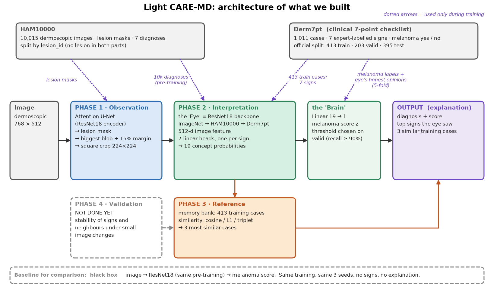
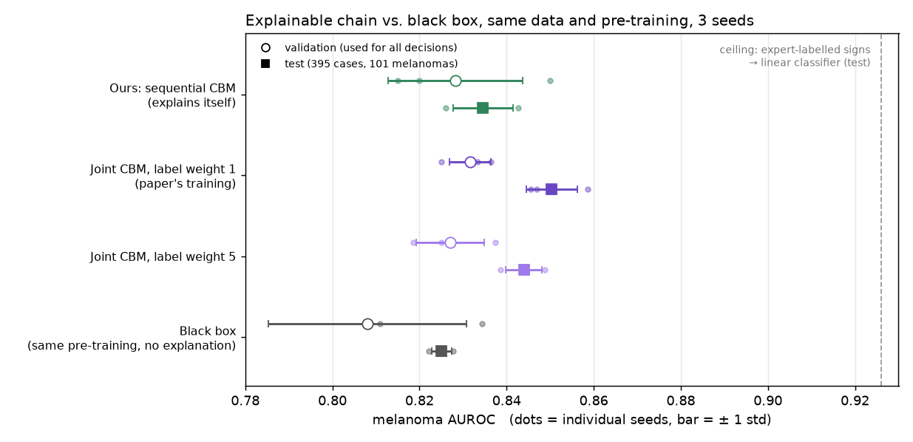

# Explainable melanoma diagnosis from dermoscopy
### A light re-implementation and critical evaluation of CARE-MD

I re-implemented, from scratch and with fair experimental controls, the self-explainable framework proposed in
*"From black-box to clinical reasoning: CARE-MD, a novel framework for Self-eXplainable skin lesions"*
(Kandpal & Verma, *Computer Methods and Programs in Biomedicine* 285 (2026) 109478,
[doi:10.1016/j.cmpb.2026.109478](https://doi.org/10.1016/j.cmpb.2026.109478)).
This is an independent study, not affiliated with the authors, not peer reviewed, and **not for clinical use**.

**The question:** can a model explain a melanoma diagnosis the way a dermatologist does (which signs are present,
which known cases look similar) without losing accuracy compared with a black box?

**Short answer, with the caveats stated honestly below:** on 395 held-out cases the explainable chain reaches
melanoma AUROC 0.835 ± 0.007 versus 0.825 ± 0.002 – 0.841 ± 0.005 for a black box given the same data and
pre-training. Within the run-to-run noise (about ±0.015) I could not measure a cost of interpretability.
Both image models remain clearly behind the classic 7-point checklist when an expert supplies the signs.



## What was built (and which CARE-MD phase it maps to)

| CARE-MD phase | Here | Status |
|---|---|---|
| 1. Observation | Attention U-Net (ResNet18 encoder) trained on HAM10000 lesion masks, then used to crop Derm7pt images around the lesion | done, Dice 0.930 / IoU 0.880 on held-out lesions |
| 2. Interpretation | "Eye": ResNet18 + 7 heads predicts the 7 clinical signs (19 class probabilities); "Brain": a 20-weight linear layer turns them into a melanoma score | done |
| 3. Reference | Retrieve the 3 most similar of 413 training cases (cosine / L1 / triplet-trained embedding) | done |
| 4. Validation | Stability of signs and neighbours under small image changes | **not done yet** |

Layer-level detail with real tensor shapes and parameter counts: [`notes/layers.png`](notes/layers.png).

Where I deliberately differ from the paper:

* **Concept labels.** The paper builds on ABCD attributes but does not say where labels come from, and neither of its
  datasets provides them. I use the **7-point checklist** annotated by experts in Derm7pt (pigment network, streaks,
  pigmentation, regression structures, dots/globules, blue-whitish veil, vascular structures). Rare levels were merged
  into clinically meaningful groups (19 columns after one-hot).
* **Two datasets.** No dataset has both masks and concepts, so segmentation learns on HAM10000 and is applied to Derm7pt.
* **Soft concepts** (probabilities) instead of thresholded 0/1 concepts.
* **Training scheme.** The main model trains the Brain *after* the Eye on the Eye's honest, out-of-fold outputs
  (sequential CBM). The paper's joint training (its Eq. 4) is implemented too and reported as an ablation.

## Results

All decisions (model choice, early stopping, thresholds) use the **validation** split only; the official Derm7pt split
(413 / 203 / 395) is used. Every comparison uses 3 random seeds (mean ± std). Test has only 101 melanomas, so
differences below ~0.015 AUROC are not claimed.



| Melanoma AUROC | validation | test |
|---|---|---|
| Ceiling: expert-labelled signs → linear classifier | – | 0.926 |
| **Ours, sequential CBM (explains itself)** | 0.828 ± 0.015 | 0.835 ± 0.007 |
| Joint CBM, label weight 1 (paper's training) | 0.832 ± 0.005 | 0.850 ± 0.006 |
| Joint CBM, label weight 5 | 0.827 ± 0.008 | 0.844 ± 0.004 |
| Black box, same pre-training (run A) | 0.808 ± 0.023 | 0.825 ± 0.002 |
| Black box, same pre-training (run B, earlier) | 0.832 ± 0.007 | 0.841 ± 0.005 |

Two independent black-box runs differ by ~0.02, which is the noise floor of this study.

What moved the numbers (validation, 3 seeds each):

| Change | Eye: mean AUROC of the 7 signs | Chain: melanoma AUROC |
|---|---|---|
| ImageNet-pretrained ResNet18 only | 0.796 ± 0.007 | 0.792 ± 0.012 |
| + intermediate fine-tuning on 10k HAM10000 lesions | **0.816 ± 0.006** (3/3 seeds) | 0.809 ± 0.012 |
| + crop around the lesion (Phase 1) vs full image | 0.827 ± 0.006 vs 0.814 ± 0.008 (3/3) | 0.806 ± 0.035 vs 0.804 ± 0.014 |
| Brain trained on the Eye's out-of-fold outputs vs on expert labels | – | **0.828 ± 0.015** vs 0.807 ± 0.018 (3/3) |

* **Joint training did not help** at the validation level. With a high label weight it *hurts interpretability*:
  sign AUROC drops by about 0.03 in 3/3 seeds with no diagnostic gain (the Eye bends its "signs" to serve the label).
* **Operating point** (threshold chosen on validation for 90% recall, applied unchanged to test): the explainable chain
  finds 89% of melanomas (≈11 of 101 missed) with 128 false alarms among 294 benign cases; the black box 88% / 132.
  The 7-point rule with **expert-provided** signs gets 95% recall with only 58 false alarms. The bottleneck is the quality of the
  predicted signs (melanoma AUROC 0.835 with the Eye's signs vs 0.926 with expert signs), not the linear Brain.
* **Retrieval (test, 3 nearest cases).** Chance for "agreement with the expert's 7 signs" is 0.52.

  | similarity | same group (melanoma / nevus / other) | sign agreement |
  |---|---|---|
  | cosine on predicted signs (paper) | 0.629 | 0.691 |
  | L1 on predicted signs (my fix for cosine's blindness to magnitude) | 0.641 | 0.688 |
  | cosine on image features | 0.658 | 0.677 |
  | triplet-trained 64-d embedding (paper) | **0.704** | 0.636 |

  Two notions of "similar" trade off: the triplet space groups same-diagnosis cases, signs-based spaces return cases that
  share the expert's signs. The L1 fix gave no measurable benefit.

## Things I could not verify in the paper

Listed from reading its text; this is not a claim of wrongdoing.

1. Dice/IoU of 0.9999 in the cross-dataset test, and Dice reported as 0.85, 0.95 and 0.99 in different tables.
2. The "cross-dataset" test on HAM10000 appears to overlap with the ISIC 2018 classification training data.
3. The appendix pseudocode has no retrieval step: its "Phase 3" is just `LabelPredictor(C)`.
4. The origin of the ABCD concept labels is not stated.
5. Cosine similarity on non-negative concept vectors cannot tell "all signs weak" from "all signs strong"
   (similarity 1.0); two of the three worked examples recompute to different values (0.36 → 0.399, 0.45 → 0.573).
6. A retrieval example shows a nearest case with similarity 1.00, suggesting the query itself was in the reference bank.

## Limitations

Small data (413 training cases, 101 test melanomas); run-to-run noise of about ±0.015 AUROC (MPS is not bit-reproducible);
a single-centre atlas; no clinician evaluation; the segmentation network is applied across datasets without reference masks
(crop quality checked visually on samples only); Phase 4 not implemented; only two joint-training weights tried.

## Repository map

| Script | Purpose |
|---|---|
| `derm7pt_data.py` | shared definitions: label-merging table, official split, augmentation, `Dataset` |
| `step1_concepts_to_diagnosis.py`, `step1b_ablation.py` | ceiling: expert signs → melanoma; effect of extra metadata |
| `step2a..2d_*.py` | images as tensors, data loading, Eye training, first full chain vs black box |
| `step3a_leakage_check.py`, `step3b_ham_pretrain.py`, `step3c_compare_eyes.py` | duplicate check between datasets, HAM10000 pre-training, fair comparison |
| `step4a_blackbox_compare.py` | black box with the same pre-training |
| `step5a..5c_*.py` | Phase 1: Attention U-Net, cropping, crop vs full image |
| `step6_sequential_brain.py` | Brain trained on out-of-fold Eye outputs |
| `step7_threshold.py` | recall-targeted thresholds chosen on validation |
| `step8_reference.py` | Phase 3 retrieval |
| `step9_joint.py` | joint CBM (paper's Eq. 4) |
| `scripts_peek*.py` | first look at the two datasets (class counts, contact sheets) |
| `draw_*.py`, `tools/` | figures, dataset download helper |
| `notes/*.csv` | per-seed result tables behind every number above |
| `docs/lab_notebook_fa.md` | working notes (Persian) |

## Reproducing

```bash
python3.11 -m venv .venv && source .venv/bin/activate     # developed with Python 3.11
pip install -r requirements.txt
bash tools/fetch_ham10000.sh                    # HAM10000 (CC BY-NC 4.0)
# Derm7pt: request access at https://derm.cs.sfu.ca (form linked on the Download page), then unzip to
#          data/derm7pt/release_v0/   (contains images/ and meta/)
python step3b_ham_pretrain.py                   # writes checkpoints/step3b_ham_backbone.pt
python step5a_train_segmentation.py && python step5b_crop_derm7pt.py
python step7_threshold.py && python step9_joint.py
```

Order dependencies: `step3b` → (`step3c`, `step4a`, `step5c`, `step6`–`step9`); `step5a`+`step5b` → `step5c`, `step6`–`step9`;
`step7` → `step9`; `step2c` → `step2d`. `run_step3.sh` / `run_step5.sh` chain the long stages. Developed on Apple Silicon
(PyTorch MPS; falls back to CPU).

## Data and licensing

**No dataset images, metadata or trained weights are redistributed here.** Derm7pt is CC BY-NC-ND 4.0 (its authors forbid
redistributing images); HAM10000 is CC BY-NC 4.0. Please obtain both from their sources and respect their terms.

* Kawahara et al., *Seven-point checklist and skin lesion classification using multitask multimodal neural nets*, IEEE JBHI 2019 (Derm7pt).
* Tschandl et al., *The HAM10000 dataset*, Scientific Data 2018.

Code is MIT-licensed (see `LICENSE`).

## Author and AI assistance

Amirmahdi Valeh ([@amvaleh](https://github.com/amvaleh)). Developed with AI coding assistance (Claude Code);
all numbers in this README come from the scripts, result tables and logs in this repository.
